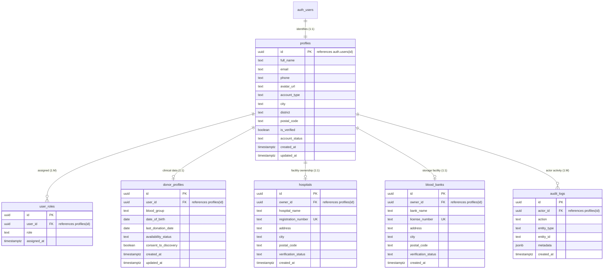
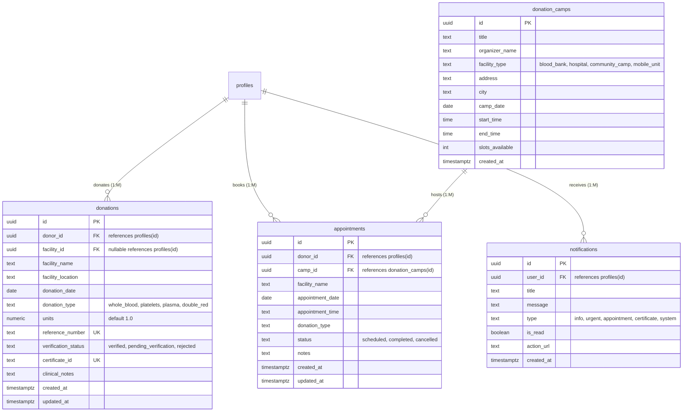
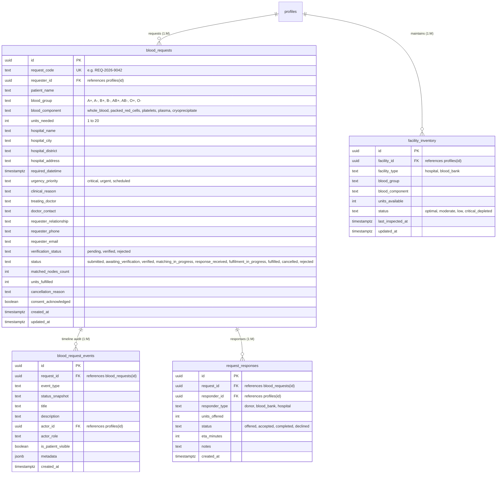

# BloodLink — Database Architecture & Schema Specification

**Database Engine**: Supabase PostgreSQL 15+  
**Schema**: `public` (integrating with `auth.users`)

---

## 1. Entity-Relationship Overview

---

## 2. Table Specifications

### 2.1 `public.profiles`
Primary identity record extending `auth.users` upon signup.

| Column | Type | Constraints | Description |
|---|---|---|---|
| `id` | `UUID` | `PRIMARY KEY`, `REFERENCES auth.users(id) ON DELETE CASCADE` | Matches auth user identifier |
| `full_name` | `TEXT` | `NOT NULL` | Display name or organization rep |
| `email` | `TEXT` | `NOT NULL`, regex check | Official email address |
| `phone` | `TEXT` | `NULLABLE` | Contact phone for SMS triage |
| `avatar_url` | `TEXT` | `NULLABLE` | Profile picture URI |
| `account_type` | `TEXT` | `CHECK IN ('donor', 'patient', 'hospital', 'blood_bank', 'admin')` | Primary platform role |
| `city` | `TEXT` | `NULLABLE` | Municipal location |
| `district` | `TEXT` | `NULLABLE` | Geographic district |
| `postal_code` | `TEXT` | `NULLABLE` | Postal code |
| `is_verified` | `BOOLEAN` | `DEFAULT FALSE`, `NOT NULL` | Verified status (cannot be self-updated) |
| `account_status` | `TEXT` | `CHECK IN ('active', 'pending_verification', 'suspended', 'deactivated')` | Lifecycle state |
| `created_at` | `TIMESTAMPTZ`| `DEFAULT NOW()`, `NOT NULL` | Creation timestamp |
| `updated_at` | `TIMESTAMPTZ`| `DEFAULT NOW()`, `NOT NULL` | Last update timestamp |

---

### 2.2 `public.user_roles`
Strictly enforced role assignments preventing privilege escalation.

| Column | Type | Constraints | Description |
|---|---|---|---|
| `id` | `UUID` | `PRIMARY KEY DEFAULT gen_random_uuid()` | Unique role ID |
| `user_id` | `UUID` | `NOT NULL`, `REFERENCES profiles(id) ON DELETE CASCADE` | Assigned user |
| `role` | `TEXT` | `CHECK IN ('donor', 'patient', 'hospital', 'blood_bank', 'super_admin')` | Specific role code |
| `assigned_at` | `TIMESTAMPTZ`| `DEFAULT NOW()`, `NOT NULL` | Assignment timestamp |

*Unique Constraint*: `UNIQUE (user_id, role)`

---

### 2.3 `public.donor_profiles`
Clinical transfusion telemetry, blood groups, and readiness settings.

| Column | Type | Constraints | Description |
|---|---|---|---|
| `id` | `UUID` | `PRIMARY KEY DEFAULT gen_random_uuid()` | Record ID |
| `user_id` | `UUID` | `UNIQUE`, `NOT NULL`, `REFERENCES profiles(id) ON DELETE CASCADE` | Associated donor user |
| `blood_group` | `TEXT` | `CHECK IN ('A+', 'A-', 'B+', 'B-', 'AB+', 'AB-', 'O+', 'O-')` | Verified blood group |
| `date_of_birth` | `DATE` | `CHECK (dob <= CURRENT_DATE - 16y)` | Donor birthdate |
| `last_donation_date` | `DATE` | `CHECK (last_donation <= CURRENT_DATE)` | Most recent whole blood draw |
| `availability_status` | `TEXT` | `CHECK IN ('available', 'unavailable', 'recently_donated')` | Readiness state |
| `consent_to_discovery` | `BOOLEAN` | `DEFAULT TRUE`, `NOT NULL` | Opt-in for emergency broadcasts |

---

### 2.4 `public.hospitals`
Registered hospital trauma wards and emergency surgery departments.

| Column | Type | Constraints | Description |
|---|---|---|---|
| `id` | `UUID` | `PRIMARY KEY DEFAULT gen_random_uuid()` | Hospital ID |
| `owner_id` | `UUID` | `NOT NULL`, `REFERENCES profiles(id) ON DELETE CASCADE` | Responsible physician or admin |
| `hospital_name` | `TEXT` | `NOT NULL` | Official hospital facility title |
| `registration_number` | `TEXT` | `NOT NULL`, `UNIQUE` | State medical board registry # |
| `address` | `TEXT` | `NOT NULL` | Physical street address |
| `city` | `TEXT` | `NOT NULL` | City |
| `postal_code` | `TEXT` | `NOT NULL` | Postal code |
| `verification_status` | `TEXT` | `CHECK IN ('pending', 'verified', 'rejected')` | Accreditation status |

---

### 2.5 `public.blood_banks`
Accredited blood banks managing inventories and cold-chain storage.

| Column | Type | Constraints | Description |
|---|---|---|---|
| `id` | `UUID` | `PRIMARY KEY DEFAULT gen_random_uuid()` | Blood bank ID |
| `owner_id` | `UUID` | `NOT NULL`, `REFERENCES profiles(id) ON DELETE CASCADE` | Responsible director |
| `bank_name` | `TEXT` | `NOT NULL` | Organization name |
| `license_number` | `TEXT` | `NOT NULL`, `UNIQUE` | Cold-chain license # |
| `address` | `TEXT` | `NOT NULL` | Physical facility address |
| `city` | `TEXT` | `NOT NULL` | City |
| `postal_code` | `TEXT` | `NOT NULL` | Postal code |
| `verification_status` | `TEXT` | `CHECK IN ('pending', 'verified', 'rejected')` | Inspection status |

---

### 2.6 `public.audit_logs`
Immutable forensic audit trail for sensitive clinical operations.

| Column | Type | Constraints | Description |
|---|---|---|---|
| `id` | `UUID` | `PRIMARY KEY DEFAULT gen_random_uuid()` | Audit entry ID |
| `actor_id` | `UUID` | `REFERENCES profiles(id) ON DELETE SET NULL` | Performing user |
| `action` | `TEXT` | `NOT NULL` | Action code (e.g. `USER_REGISTERED`, `EMERGENCY_BEACON_DISPATCHED`) |
| `entity_type` | `TEXT` | `NOT NULL` | Target table name |
| `entity_id` | `TEXT` | `NULLABLE` | Target record identifier |
| `metadata` | `JSONB` | `DEFAULT '{}'::jsonb`, `NOT NULL` | Event context & telemetry |
| `created_at` | `TIMESTAMPTZ`| `DEFAULT NOW()`, `NOT NULL` | Event timestamp |

---

## 3. Phase 3: Donor Command Center Schema Extensions

Migration: `supabase/migrations/20261124000004_donor_command_center.sql`

### 3.1 `public.donations`
Clinical records of verified blood donations.
- **Transfusion Rule**: 1 unit whole blood = 3 potential lives saved.
- **Security / RLS Constraint**: Donors CANNOT self-verify donations. Only accredited hospital, blood bank, or admin roles can insert or verify donation records.

| Column | Type | Constraints | Description |
|---|---|---|---|
| `id` | `UUID` | `PRIMARY KEY DEFAULT gen_random_uuid()` | Record ID |
| `donor_id` | `UUID` | `NOT NULL`, `REFERENCES profiles(id) ON DELETE CASCADE` | Donor user ID |
| `facility_id` | `UUID` | `NULLABLE`, `REFERENCES profiles(id) ON DELETE SET NULL` | Performing medical facility |
| `facility_name` | `TEXT` | `NOT NULL` | Facility name |
| `facility_location`| `TEXT` | `NULLABLE` | Facility address/city |
| `donation_date` | `DATE` | `NOT NULL`, `CHECK (donation_date <= CURRENT_DATE)` | Date of donation |
| `donation_type` | `TEXT` | `CHECK IN ('whole_blood', 'platelets', 'plasma', 'double_red')` | Component donated |
| `units` | `NUMERIC` | `NOT NULL DEFAULT 1.0`, `CHECK (units > 0)` | Volume in units (1 unit ~ 450 mL) |
| `reference_number`| `TEXT` | `UNIQUE NOT NULL` | Clinical audit identifier (`BL-DON-YYYY-XXXX`) |
| `verification_status`| `TEXT`| `CHECK IN ('pending_verification', 'verified', 'rejected')` | Hospital verification state |
| `certificate_id` | `TEXT` | `UNIQUE NULLABLE` | Digital certificate ID |
| `clinical_notes` | `TEXT` | `NULLABLE` | Hemoglobin / laboratory notes |

---

### 3.2 `public.donation_camps`
Public community drives and fixed collection center schedules.

| Column | Type | Constraints | Description |
|---|---|---|---|
| `id` | `UUID` | `PRIMARY KEY DEFAULT gen_random_uuid()` | Camp ID |
| `title` | `TEXT` | `NOT NULL` | Camp or drive name |
| `organizer_name` | `TEXT` | `NOT NULL` | Organization name |
| `facility_type` | `TEXT` | `CHECK IN ('blood_bank', 'hospital', 'community_camp', 'mobile_unit')` | Venue category |
| `address` | `TEXT` | `NOT NULL` | Venue address |
| `city` | `TEXT` | `NOT NULL` | City |
| `camp_date` | `DATE` | `NOT NULL` | Date of drive |
| `start_time` | `TIME` | `NOT NULL` | Starting time |
| `end_time` | `TIME` | `NOT NULL` | Ending time |
| `slots_available` | `INT` | `DEFAULT 40`, `CHECK (slots_available >= 0)` | Open booking slots |

---

### 3.3 `public.appointments`
Donor bookings for express fast-track donation slots.

| Column | Type | Constraints | Description |
|---|---|---|---|
| `id` | `UUID` | `PRIMARY KEY DEFAULT gen_random_uuid()` | Appointment ID |
| `donor_id` | `UUID` | `NOT NULL`, `REFERENCES profiles(id) ON DELETE CASCADE` | Registered donor |
| `camp_id` | `UUID` | `NULLABLE`, `REFERENCES donation_camps(id) ON DELETE SET NULL` | Linked camp drive |
| `facility_name` | `TEXT` | `NOT NULL` | Center name |
| `appointment_date`| `DATE` | `NOT NULL` | Scheduled date |
| `appointment_time`| `TEXT` | `NOT NULL` | Time slot |
| `donation_type` | `TEXT` | `CHECK IN ('whole_blood', 'platelets', 'plasma', 'double_red')` | Donation type |
| `status` | `TEXT` | `CHECK IN ('scheduled', 'completed', 'cancelled')` | Appointment state |
| `notes` | `TEXT` | `NULLABLE` | Donor notes |

---

### 3.4 `public.notifications`
Real-time transactional and emergency notification feed for in-app display.

| Column | Type | Constraints | Description |
|---|---|---|---|
| `id` | `UUID` | `PRIMARY KEY DEFAULT gen_random_uuid()` | Notification ID |
| `user_id` | `UUID` | `NOT NULL`, `REFERENCES profiles(id) ON DELETE CASCADE` | Recipient user ID |
| `title` | `TEXT` | `NOT NULL` | Alert headline |
| `message` | `TEXT` | `NOT NULL` | Detailed message |
| `type` | `TEXT` | `CHECK IN ('info', 'urgent', 'appointment', 'certificate', 'system')` | Priority level |
| `is_read` | `BOOLEAN` | `DEFAULT FALSE`, `NOT NULL` | Read receipt flag |
| `action_url` | `TEXT` | `NULLABLE` | Deep-link destination |

---

## 4. Patient Emergency Portal & Blood Request Schema Extensions

Migration: `supabase/migrations/20261124000005_patient_emergency_portal.sql`

### 4.1 `public.blood_requests`
Primary repository of patient emergency transfusion requisitions.
- **Constraints**:
  - `blood_group` validated against standard 8 ABO/Rh types.
  - `blood_component` validated against WHO standard transfusion categories.
  - `units_needed` bounded between 1 and 20.
  - Automatic `request_code` generation trigger formatted as `REQ-YYYY-XXXXX`.
- **Row Level Security**:
  - Patients can only view and create requests linked to their own user ID (`requester_id = auth.uid()`).
  - Patients can only set status to `cancelled`. They cannot self-verify or mark fulfilled.
  - Only hospital and blood bank accounts can verify requests or mark them fulfilled.

### 4.2 `public.blood_request_events`
Append-only clinical timeline audit log tracking every milestone of a blood request.
- Automatically populated via trigger on request creation.
- Stores historical status snapshots, actor IDs, and patient visibility flags.

### 4.3 `public.request_responses`
Tracks donor commitments and blood bank reserve allocations in response to active emergency broadcasts.
- Donor personal contact details are masked to preserve privacy until clinical confirmation.

### 4.4 `public.facility_inventory`
Accredited hospital and blood bank verified blood reserve batches.
- Unique constraint on `(facility_id, blood_group, blood_component)` prevents duplicate batch rows.
- Publicly inspectable; modifiable only by the authenticated facility owner.

---

## 5. Intelligent Matching & Discovery Engine Schema

```mermaid
erDiagram
    matching_rule_versions ||--o{ matching_runs : "evaluates with (1:M)"
    blood_requests ||--o{ matching_runs : "triggers (1:M)"
    matching_runs ||--o{ matching_candidates : "produces (1:M)"
    blood_requests ||--o{ donor_request_invitations : "broadcasts (1:M)"
    profiles ||--o{ donor_request_invitations : "receives (1:M)"
    blood_requests ||--o{ inventory_reservations : "reserves (1:M)"
    facility_inventory ||--o{ inventory_reservations : "allocated from (1:M)"

    matching_rule_versions {
        uuid id PK
        text version_code UK "e.g. CLINICAL-AABB-2026.1"
        text title
        text authority
        text reviewer_name
        jsonb rules_matrix
        text status "approved, draft_unapproved, revoked"
        timestamptz approved_at
        timestamptz created_at
    }

    matching_runs {
        uuid id PK
        uuid request_id FK "references blood_requests(id)"
        uuid triggered_by FK "references profiles(id)"
        uuid rule_version_id FK "references matching_rule_versions(id)"
        text status "running, completed, failed, pending_clinical_review"
        int candidates_found
        int donors_matched
        int facilities_matched
        int execution_time_ms
        numeric search_radius_km
        jsonb metadata
        timestamptz created_at
    }

    matching_candidates {
        uuid id PK
        uuid run_id FK "references matching_runs(id)"
        uuid request_id FK "references blood_requests(id)"
        text candidate_type "donor, facility_inventory"
        uuid candidate_id "anonymized reference"
        numeric match_score "0.0 - 100.0"
        numeric distance_km
        text location_quality "exact_city, district, regional_transit"
        boolean is_compatible
        text compatibility_status "approved, pending_review, incompatible"
        jsonb match_explanation
        timestamptz created_at
    }

    donor_request_invitations {
        uuid id PK
        uuid candidate_id FK "references matching_candidates(id)"
        uuid request_id FK "references blood_requests(id)"
        uuid donor_id FK "references profiles(id)"
        text status "pending, accepted, declined, withdrawn, expired"
        timestamptz responded_at
        timestamptz expires_at
        text response_notes
        timestamptz created_at
        timestamptz updated_at
    }

    inventory_reservations {
        uuid id PK
        text reservation_code UK "Trigger-generated RSV-YYYY-XXXXX"
        uuid inventory_id FK "references facility_inventory(id)"
        uuid request_id FK "references blood_requests(id)"
        uuid facility_id FK "references profiles(id)"
        int units_reserved
        text status "reserved, confirmed, released, expired"
        timestamptz expires_at
        uuid confirmed_by FK "references profiles(id)"
        timestamptz released_at
        timestamptz created_at
        timestamptz updated_at
    }

    facility_staff {
        uuid id PK
        uuid facility_id FK "references profiles(id)"
        uuid user_id FK "references profiles(id)"
        text staff_role "medical_officer, transfusion_technician, inventory_manager, lab_technician, blood_bank_director, coordinator"
        text department
        text license_number
        boolean is_active
        timestamptz created_at
    }

    component_batches {
        uuid id PK
        uuid facility_id FK "references profiles(id)"
        text batch_number UK "Trigger-generated [PREFIX]-YYYY-XXXXX"
        text component_type "packed_red_cells, whole_blood, platelets, fresh_frozen_plasma, cryoprecipitate"
        text blood_group "A+, A-, B+, B-, AB+, AB-, O+, O-"
        numeric volume_ml
        text anticoagulant
        timestamptz collection_date
        timestamptz expiry_date "Trigger-calculated per component type"
        text storage_location
        numeric storage_temperature
        text status "quarantined, available, reserved, dispatched, transfused, discarded"
        uuid parent_batch_id FK "references component_batches(id)"
        timestamptz created_at
        timestamptz updated_at
    }

    component_processing_events {
        uuid id PK
        uuid facility_id FK "references profiles(id)"
        uuid parent_batch_id FK "references component_batches(id)"
        text process_type "centrifugation, apheresis_fractionation, cryo_precipitation"
        jsonb daughter_batch_ids
        uuid processed_by FK "references profiles(id)"
        text notes
        timestamptz created_at
    }

    inventory_quality_checks {
        uuid id PK
        uuid batch_id FK "references component_batches(id)"
        text test_name
        boolean hiv_screening
        boolean hbv_screening
        boolean hcv_screening
        boolean syphilis_screening
        boolean malaria_screening
        text overall_result "passed, failed, pending"
        uuid tested_by FK "references profiles(id)"
        text notes
        timestamptz created_at
    }

    inventory_movements {
        uuid id PK
        uuid batch_id FK "references component_batches(id)"
        uuid facility_id FK "references profiles(id)"
        text movement_type "intake, separation, quarantine_release, reservation, dispatch, transfer_receive, administration, discard"
        text previous_status
        text new_status
        uuid performed_by FK "references profiles(id)"
        jsonb movement_details
        timestamptz created_at
    }

    dispatch_records {
        uuid id PK
        text dispatch_code UK "Trigger-generated DSP-YYYY-XXXXX"
        uuid sender_facility_id FK "references profiles(id)"
        uuid recipient_facility_id FK "references profiles(id)"
        uuid request_id FK "references blood_requests(id)"
        jsonb batch_ids
        numeric core_temp_at_dispatch
        numeric core_temp_at_delivery
        text transport_carrier
        text tracking_number
        text status "dispatched, in_transit, delivered, rejected, cancelled"
        timestamptz dispatched_at
        timestamptz delivered_at
        timestamptz created_at
    }

    fulfilment_records {
        uuid id PK
        uuid request_id FK "references blood_requests(id)"
        uuid hospital_id FK "references profiles(id)"
        uuid batch_id FK "references component_batches(id)"
        text recipient_blood_group
        text donor_blood_group
        text crossmatch_status "compatible, incompatible, not_performed"
        text crossmatch_method
        boolean crossmatch_verified
        uuid administered_by FK "references profiles(id)"
        timestamptz administered_at
        text adverse_reaction
        text notes
        timestamptz created_at
    }

    inventory_alerts {
        uuid id PK
        uuid facility_id FK "references profiles(id)"
        text alert_type "critical_shortage, expiring_soon, temperature_excursion, contamination_detected"
        text blood_group
        text component_type
        text severity "critical, warning, info"
        text message
        boolean is_resolved
        timestamptz resolved_at
        timestamptz created_at
    }
```

### 5.1 `public.matching_rule_versions`
Audited provenance records for clinical transfusion matrices:
- Seeded with `CLINICAL-AABB-2026.1`.
- Verified by medical board review.
- Fail-safe constraint: If status is not `approved`, matching automatically halts in `pending_clinical_review`.

### 5.2 `public.matching_runs`
Telemetry audit table capturing every matching run execution:
- Tracks execution latency (`execution_time_ms`), candidate discovery volume, search radius, and governing ruleset.

### 5.3 `public.matching_candidates`
Ranked candidate evaluation results produced per matching run:
- Stores composite match scores (0-100), location quality categories, approximate distances, and clinical explanation JSON.

### 5.4 `public.donor_request_invitations`
Privacy-preserving broadcast invitations dispatched to consenting donors:
- Unique constraint `(request_id, donor_id)` prevents spam and duplicate broadcast notifications.
- Expiration tracking (`expires_at`) auto-closes stale broadcast calls.
- Strict RLS: Requesters can see aggregated response statuses; donors only see invitations dispatched to their own profile.

### 5.5 `public.inventory_reservations`
Atomic cold-chain inventory allocations across hospitals and blood banks:
- Database trigger `generate_reservation_code()` assigns sequential `RSV-YYYY-XXXXX` codes.
- Concurrency control prevents double allocation and race conditions during simultaneous emergency trauma requisitions.
- Units are locked with automatic release upon expiration or manual release by authorized medical personnel.

---

## 6. Hospital & Blood Bank Management Tables

### 6.1 `public.facility_staff`
Granular institutional staff role bindings and departmental licenses:
- Enforces role-based permissions (`medical_officer`, `transfusion_technician`, `inventory_manager`, `lab_technician`, `blood_bank_director`, `coordinator`).
- Governed by security function `is_facility_staff(auth.uid(), facility_id)`.

### 6.2 `public.component_batches`
Traceable therapeutic blood unit storage and inventory:
- Trigger-generated batch codes: `PRBC-YYYY-XXXXX`, `WBLD-YYYY-XXXXX`, `PLTS-YYYY-XXXXX`, `FFPL-YYYY-XXXXX`, `CRYO-YYYY-XXXXX`.
- Automated shelf-life triggers enforce 5-day expiration for Platelets, 42-day for PRBC, 35-day for Whole Blood, and 365-day for Plasma and Cryoprecipitate.

### 6.3 `public.component_processing_events`
Parent-child centrifugation and separation audit:
- Links daughter units (PRBC, FFP, Platelets) to their parent whole blood collection batch (`parent_batch_id`).

### 6.4 `public.inventory_quality_checks`
Mandatory 5-point infectious disease laboratory testing ledger:
- Records HIV, HBV, HCV, Syphilis, and Malaria assay outcomes.
- Triggers automatic release to `available` status or immediate biohazard quarantine upon reactivity.

### 6.5 `public.inventory_movements`
Append-only forensic custody and state-change ledger:
- Tracks all unit transitions (`intake`, `separation`, `quarantine_release`, `reservation`, `dispatch`, `transfer_receive`, `administration`, `discard`).

### 6.6 `public.dispatch_records`
Cold-chain transport manifests and delivery receipts:
- Trigger-generated sequential dispatch codes: `DSP-YYYY-XXXXX`.
- Captures departure core temperatures, courier identifiers, and destination acceptance temperatures.

### 6.7 `public.fulfilment_records`
Clinical crossmatch verification and transfusion administration:
- Enforces crossmatch compatibility verification constraint before clinical blood release.
- Records administering clinician UUID, baseline vitals, and adverse transfusion reaction telemetry.

### 6.8 `public.inventory_alerts`
Real-time cold-chain alarms and shortage thresholds:
- Monitors critical shortages, near-expiry units, and vault temperature excursions.

---

## 7. Super Admin & Platform Intelligence Tables

### 7.1 `public.admin_roles`
Granular administrative role bindings and least-privilege assignments:
- Enforces roles: `super_admin`, `operations_admin`, `verification_admin`, `security_auditor`, `analytics_viewer`.
- Managed strictly by verified Super Admins; ordinary users and administrators cannot grant or elevate administrative privileges.
- Helper functions: `is_super_admin(UUID)` and `has_admin_role(UUID, TEXT)`.

### 7.2 `public.facility_verification_reviews`
Institutional accreditation ledger for hospitals and blood banks:
- Tracks review decisions (`approved`, `rejected`, `additional_documentation_requested`, `suspended`, `reinstated`).
- Mandatory audit justification, verified medical license number, accreditation body, and physical cold-chain audit verification flag.

### 7.3 `public.admin_action_logs`
Append-only, immutable forensic audit ledger:
- Records all privileged administrative mutations: user status changes, facility accreditation decisions, broadcasts, and configuration updates.
- `UPDATE` and `DELETE` permissions are revoked across all roles.

### 7.4 `public.security_incidents`
Security Operations Center (SOC) incident tracking:
- Trigger-generated sequential incident codes: `INC-YYYY-XXXXX`.
- Captures incident severity (`critical`, `high`, `medium`, `low`, `informational`), status (`investigating`, `contained`, `resolved`, `false_positive`), forensic notes, and resolution summaries.

### 7.5 `public.platform_announcements`
Targeted platform broadcast and notification center:
- Trigger-generated sequential codes: `ANN-YYYY-XXXXX`.
- Target audiences: `all`, `donors`, `patients`, `hospitals`, `blood_banks`.
- Priority levels: `critical`, `urgent`, `standard`.

### 7.6 `public.system_configuration`
Platform-wide operational and emergency settings:
- Categories: `emergency`, `matching`, `inventory`, `registration`, `security`, `clinical`.
- Clinical Governance Protection: Trigger `trg_protect_clinical_rules` strictly blocks casual modification of biological transfusion compatibility rules unless verified `medical_board_approval_token` is provided.
