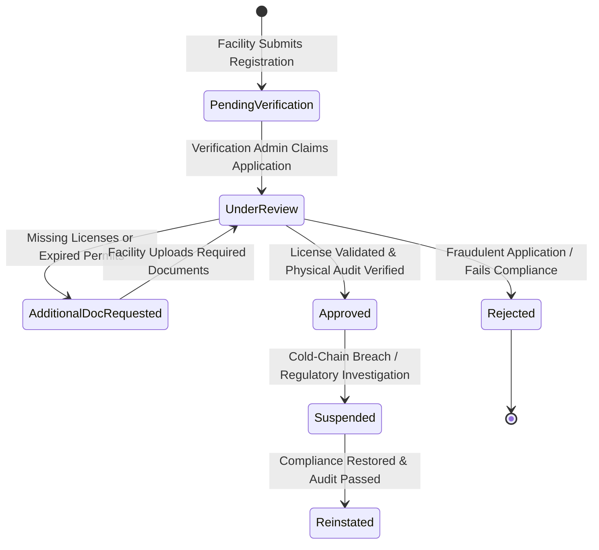

# BloodLink – Facility Accreditation & Verification Workflow

## 1. Overview

To guarantee clinical safety and cold-chain compliance, no hospital or blood bank can access regional emergency matching, reserve blood units, or record transfusions until formally accredited by an authorized administrator (`verification_admin` or `super_admin`).

---

## 2. Review Requirements & Checklist

Every accreditation review requires documented inspection of:

1. **State Medical License**:
   - Verification of active hospital registration number or blood establishment operating license with state/federal health authorities.
   - Entry of validated license number in review record.
2. **Accreditation Authority**:
   - Joint Commission, AABB, Council of Europe, or National Blood Transfusion Council accreditation certificate inspection.
3. **Physical / On-Site Cold-Chain Audit**:
   - Confirmation that storage freezers ($-22^\circ\text{C}$), blood bank cold rooms ($2.0^\circ\text{C} - 6.0^\circ\text{C}$), and platelet incubators with continuous agitation ($20.0^\circ\text{C} - 24.0^\circ\text{C}$) are certified with automated IoT logging.
4. **Administrative Justification**:
   - Mandatory minimum 5-character audit justification logged to `public.facility_verification_reviews` and `public.admin_action_logs`.

---

## 3. Decision Outcomes & System Effects

| Decision | State Transition | Platform Effects |
|----------|------------------|------------------|
| **Approved** | `pending_verification` $\rightarrow$ `verified` | Unlocks emergency blood requisitions, donor coordination, crossmatch authorization, and regional inventory reservation. |
| **Rejected** | `pending_verification` $\rightarrow$ `rejected` | Blocks facility access; archives application with forensic reason. |
| **Additional Documentation** | `pending_verification` $\rightarrow$ `pending_info` | Dispatches notification to applicant specifying missing regulatory filings. |
| **Suspended** | `verified` $\rightarrow$ `suspended` | Immediately locks on-site inventory from matching discovery and disables new emergency broadcasts. |
| **Reinstated** | `suspended` $\rightarrow$ `verified` | Restores normal operations following remediation audit. |
