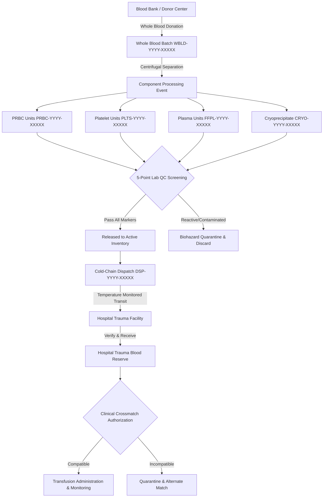

# BloodLink – Hospital & Blood Bank Command Center Architecture

## 1. System Overview

The **BloodLink Hospital & Blood Bank Management System** is an enterprise-grade clinical logistics and transfusion safety platform integrated directly with the BloodLink Intelligent Blood Matching and Emergency Network. Designed for Level-1 trauma centers, regional healthcare networks, and certified blood establishments, it provides strict chain-of-custody tracking, cold-chain monitoring, parent-child component separation, laboratory infectious disease screening, and clinical crossmatch verification.

---

## 2. Hospital Command Center Architecture

The Hospital Command Center (`hospital-dashboard.html`) is structured into **13 specialized operational modules** supporting surgeons, transfusionists, hematologists, and clinical coordinators:

| # | Module | DOM Identifier | Primary Clinical Function |
|---|--------|----------------|---------------------------|
| 1 | **Hospital Overview** | `#tab-overview` | Real-time trauma metrics, critical alerts, pending verifications, rapid actions, and micro 3D erythrocyte visualizer. |
| 2 | **Emergency Request Management** | `#tab-requests` | Filterable triage list (Code-Red, Urgent, Routine), clinical status badges, and request verification drawer. |
| 3 | **Trauma Blood Reserve** | `#tab-inventory` | On-site hospital stock across all 8 ABO/RhD blood groups and components, storage vault temperature monitoring. |
| 4 | **Matching Results** | `#tab-matching` | Direct bridge to BloodLink Matching Engine matches, ranking donor options and inter-facility transfer reserves. |
| 5 | **Donor Coordination** | `#tab-donors` | Direct secure dispatch of clinical emergency invitations, availability tracking, and commitment logs. |
| 6 | **Blood Bank Coordination** | `#tab-bloodbanks` | Regional blood bank supply directory, inter-facility transfer requests, and real-time stock inquiry. |
| 7 | **Donation Records** | `#tab-donations` | In-hospital voluntary and replacement donation intake, donor identity check, and medical certificate generation. |
| 8 | **Transfusion Fulfilment** | `#tab-fulfilment` | Complete crossmatching pipeline, recipient verification, unit release, transfusion monitoring, and reaction logging. |
| 9 | **Medical Staff Management** | `#tab-staff` | Role-based clinical team roster, shift allocation, credential verification, and facility access auditing. |
| 10 | **Reports & Analytics** | `#tab-reports` | Monthly crossmatch-to-transfusion ratio (C:T), inventory turnover, wastage analysis, and response time metrics. |
| 11 | **Notifications & Alerts** | `#tab-notifications` | Real-time code-red broadcast alerts, critical threshold warnings, and transfer delivery tracking. |
| 12 | **Facility Settings** | `#tab-settings` | Trauma level designation, cold storage temperature alarms, dispatch contact configuration, and webhook endpoints. |
| 13 | **Verification & Crossmatch Modals** | `#verification-modal`, `#fulfilment-modal` | Interactive physician authorization modal and laboratory crossmatching documentation dialog. |

### Statutory Clinical Disclaimer
All hospital interfaces prominently feature the mandatory statutory medical disclaimer:
> **CLINICAL BLOOD COMPATIBILITY & CROSSMATCHING NOTICE**  
> Selecting a blood group or component does not establish transfusion compatibility. BloodLink facilitates logistics, inventory discovery, and donor communications. All clinical compatibility, antibody screening, and crossmatching must be verified and authorized by qualified medical transfusion professionals at this hospital facility.

---

## 3. Blood Bank Command Center Architecture

The Blood Bank Command Center (`bloodbank-dashboard.html`) is designed for regulatory compliance (FDA/AABB/DGHS/WHO standards) and contains **15 operational modules**:

| # | Module | DOM Identifier | Primary Clinical / Operational Function |
|---|--------|----------------|-----------------------------------------|
| 1 | **Blood Bank Overview** | `#tab-overview` | Total inventory units, daily collection count, quarantine counts, 4-tier cold vault temperatures, and micro 3D cell sim. |
| 2 | **Component Stock & Batch Intake** | `#tab-components` | Complete $8 \times 5$ inventory matrix (8 ABO/RhD groups $\times$ 5 components), batch registration dialog with shelf-life calculator. |
| 3 | **Component Shelf-Life & Vaults** | `#tab-shelflife` | Live thermal monitoring of Walk-In Freezers ($-22^\circ\text{C}$), Cold Rooms ($4.2^\circ\text{C}$), Platelet Agitator Incubators ($22.1^\circ\text{C}$), and Ultra-Low Cryo Vaults. |
| 4 | **Laboratory QC Screening** | `#tab-qc` | Mandatory 5-point infectious disease test logging (HIV, HBV, HCV, Syphilis, Malaria) with auto-quarantine. |
| 5 | **Expiry Monitoring** | `#tab-expiry` | High-risk unit countdowns, acute platelet expiry alerts (5 days), FEFO (First-Expired, First-Out) dispatch prioritizer. |
| 6 | **Incoming Emergency Requests** | `#tab-requests` | Real-time hospital trauma requisitions with one-click reserve allocation and dispatch trigger. |
| 7 | **Component Separation** | `#tab-processing` | Parent-child centrifuge separation tracker (Whole Blood $\rightarrow$ PRBC + FFP + Platelets) with volume reconciliation. |
| 8 | **Cold-Chain Dispatches** | `#tab-dispatches` | Transit manifest generation (`DSP-YYYY-XXXXX`), carrier selection, cold-box sensor calibration, and digital delivery receipt. |
| 9 | **Active Stock Reservations** | `#tab-reservations` | Real-time lock list preventing double-allocation while hospital transport is en route. |
| 10 | **Lab & Vault Staff** | `#tab-staff` | Technician and lab manager certifications, shift logs, and quality check auditor assignments. |
| 11 | **Regulatory Reports** | `#tab-reports` | Form 27C / National Blood Transfusion Council compliance exports, discard audits, and component yield rates. |
| 12 | **Shortage & Threshold Alerts** | `#tab-notifications` | Automated low-stock alarms with automatic notification dispatch to regional voluntary donors. |
| 13 | **Vault Sensor Settings** | `#tab-settings` | IoT temperature probe integration, calibration tolerances ($\pm 0.5^\circ\text{C}$), and SMS/webhook alert rules. |
| 14 | **Batch Registration Modal** | `#register-batch-modal` | Barcode scanning, volume entry, anticoagulant selection, and automated shelf-life computation. |
| 15 | **Laboratory QC & Discard Modals** | `#qc-modal`, `#discard-modal`, `#dispatch-modal` | Laboratory diagnostic recording, biohazard destruction documentation, and cold-box courier dispatch handoff. |

---

## 4. Role-Based Access Control Matrix

The BloodLink facility subsystem enforces granular permissions governed by PostgreSQL Row Level Security (RLS) and Flask JWT middleware:

| Role Identifier | Title | Permissions |
|-----------------|-------|-------------|
| `medical_officer` | Attending Physician / Surgeon | Verify patient requests, review crossmatch records, authorize emergency blood release, approve adverse reaction logs. |
| `transfusion_technician` | Transfusion Laboratory Specialist | Perform and record recipient crossmatch (major & minor), record administration, log vital signs and transfusion reactions. |
| `inventory_manager` | Hospital Blood Reserve Officer | Receive inter-facility dispatches, monitor on-site trauma reserves, manage low-stock alerts, track unit movement. |
| `lab_technician` | Blood Bank QC Specialist | Perform infectious disease screening (5-point assay), execute component separation events, log discard documentation. |
| `blood_bank_director` | Establishment Director / Pathologist | Authorize batch quarantine release, certify regulatory submissions, override discard approvals, manage facility staff. |
| `coordinator` | Logistics & Dispatch Handler | Create cold-chain dispatches (`DSP-YYYY-XXXXX`), manage courier handoffs, monitor logger temperatures in transit. |

---

## 5. Security Architecture & Isolation

1. **Multi-Tenant Facility Isolation**:
   Every database query and mutation executes against RLS policies verifying `is_facility_staff(auth.uid(), facility_id)`. Staff members from Facility A cannot access, query, or mutate inventory, dispatches, or donor records belonging to Facility B.
2. **Immutable Inventory Movements Audit Log**:
   All state transitions (`intake`, `separated`, `reserved`, `released`, `dispatched`, `received`, `transfused`, `discarded`) trigger append-only inserts into `inventory_movements` capturing previous and new status, changed by staff UUID, and ISO timestamps.
3. **No Service-Role Key in Frontend**:
   All frontend operations execute via Supabase anonymous authentication tokens or through the Python Flask REST API (`/api/facility/*`) using validated Bearer JWT tokens.
