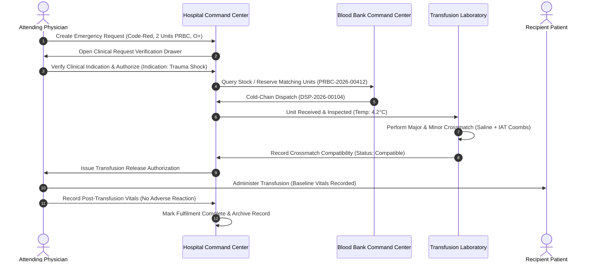

# BloodLink – Inventory Management & Quality Assurance Specification

## 1. Component Preservation Standards

BloodLink adheres strictly to international hemovigilance specifications (AABB, Council of Europe, WHO, and National Blood Transfusion Council regulations) for storage temperature, shelf-life, and preservation mechanics:

| Component Name | Standard Prefix | Storage Temperature | Permissible Shelf Life | Preservative / Container | Critical Clinical Rule |
|----------------|-----------------|---------------------|------------------------|--------------------------|------------------------|
| **Platelets (Random & Apheresis)** | `PLTS-` | **$20.0^\circ\text{C}$ to $24.0^\circ\text{C}$** | **5 Days** (120 Hours) | Continuous Agitation, Gas-permeable polyolefin bag | **NEVER REFRIGERATE AT $4^\circ\text{C}$**. Refrigeration induces irreversible platelet activation, aggregation, and immediate hepatic clearance. |
| **Packed Red Blood Cells (PRBC)** | `PRBC-` | **$2.0^\circ\text{C}$ to $6.0^\circ\text{C}$** | **42 Days** | SAGM (Saline-Adenine-Glucose-Mannitol) additive solution | Viability requires continuous cold storage. Thermal breach $>10^\circ\text{C}$ for $>30$ mins mandates biohazard discard. |
| **Whole Blood** | `WBLD-` | **$2.0^\circ\text{C}$ to $6.0^\circ\text{C}$** | **35 Days** | CPDA-1 (Citrate-Phosphate-Dextrose-Adenine) | Stored unseparated for massive transfusion protocols (MTP) and field trauma resuscitation. |
| **Fresh Frozen Plasma (FFP)** | `FFPL-` | **$\le -18.0^\circ\text{C}$** | **365 Days** (1 Year) | Frozen within 8 hours of phlebotomy | Thaw at $30.0^\circ\text{C} - 37.0^\circ\text{C}$ in calibrated water bath prior to administration; infuse within 24h once thawed. |
| **Cryoprecipitate** | `CRYO-` | **$\le -18.0^\circ\text{C}$** | **365 Days** (1 Year) | Prepared from slow thaw of FFP at $4^\circ\text{C}$ | Enriched in Factor VIII, von Willebrand factor, and Fibrinogen ($>150\text{ mg}$ per unit). |

---

## 2. Automated Shelf-Life Calculation Engine

The database trigger `trg_calculate_shelf_life` computes the exact `expiry_date` at the database level upon batch insertion:

```sql
CREATE OR REPLACE FUNCTION calculate_component_shelf_life()
RETURNS TRIGGER AS $$
BEGIN
    IF NEW.component_type = 'platelets' THEN
        NEW.expiry_date := NEW.collection_date + INTERVAL '5 days';
    ELSIF NEW.component_type = 'packed_red_cells' THEN
        NEW.expiry_date := NEW.collection_date + INTERVAL '42 days';
    ELSIF NEW.component_type = 'whole_blood' THEN
        NEW.expiry_date := NEW.collection_date + INTERVAL '35 days';
    ELSIF NEW.component_type IN ('fresh_frozen_plasma', 'cryoprecipitate') THEN
        NEW.expiry_date := NEW.collection_date + INTERVAL '365 days';
    ELSE
        NEW.expiry_date := NEW.collection_date + INTERVAL '35 days';
    END IF;
    RETURN NEW;
END;
$$ LANGUAGE plpgsql;
```

---

## 3. Parent-Child Component Separation Protocol

Whole blood collected in multi-bag systems is separated into therapeutic fractions via refrigerated centrifugation:

```
[Parent Batch: WBLD-2026-00412] (450 mL Whole Blood in CPDA-1)
       │
       ├─► Heavy Spin (Centrifuge: 4,000 RPM @ 4°C, 10 min)
       │      ├─► Packed Red Blood Cells (PRBC-2026-00412) ~ 250 mL
       │      └─► Platelet-Rich Plasma (Supernatant)
       │
       └─► Light Spin (Centrifuge: 2,000 RPM @ 22°C, 5 min)
              ├─► Platelet Concentrate (PLTS-2026-00412) ~ 55 mL
              └─► Platelet-Poor Plasma
                     ├─► Rapid Blast Freezing (-40°C) ──► Fresh Frozen Plasma (FFPL-2026-00412) ~ 200 mL
                     └─► Controlled Thaw (4°C) ──► Centrifuge ──► Cryoprecipitate (CRYO-2026-00412) ~ 15 mL
```

### Traceability Rules:
1. Every daughter unit preserves the parent batch barcode reference (`parent_batch_id`).
2. Daughter units inherit the donor's ABO/RhD blood grouping and infectious disease screening results.
3. Total volume across child components must reconcile with initial phlebotomy volume within a $\pm 5\%$ tolerance.
4. Database records are persisted in `component_processing_events`.

---

## 4. Five-Point Infectious Disease Screening Protocol

No blood unit can transition from `quarantine` to `available` status without passing five mandatory laboratory diagnostic assays recorded in `inventory_quality_checks`:

1. **HIV-1 & HIV-2**: 4th generation Antigen/Antibody combo ELISA + Nucleic Acid Testing (NAT).
2. **Hepatitis B Surface Antigen (HBsAg)**: Chemiluminescent microparticle immunoassay (CMIA) + HBV NAT.
3. **Hepatitis C Virus (HCV)**: Anti-HCV ELISA + HCV RNA NAT.
4. **Syphilis (Treponema pallidum)**: Venereal Disease Research Laboratory (VDRL) / Rapid Plasma Reagin (RPR) + TPHA confirmation.
5. **Malaria**: Rapid Diagnostic Test (RDT for Pf/Pv antigen) and thick/thin peripheral blood smear microscopy.

### Release & Destruction Rules:
- **All 5 Tests Negative**: Automated database trigger transitions batch status to `available`. Unit is released for hospital reservation and matching.
- **Any Test Reactive**: Automated trigger updates batch status to `quarantined_reactive`. The batch is locked from discovery, a biohazard alert is dispatched to the blood bank director, and the discard modal records incineration protocol and biohazard tracking number.

---

## 5. Cold-Chain Dispatch & Transit Logistics

When blood units are dispatched from a blood bank to a hospital emergency room, a cold-chain manifest is created (`dispatch_records`):

1. **Dispatch Code Format**: Automated trigger generates sequential tracking IDs formatted as `DSP-YYYY-XXXXX` (e.g. `DSP-2026-00104`).
2. **Packaging Standards**:
   - PRBC & Whole Blood: Validated isothermal polystyrene shipper with conditioned frozen gel packs, maintained strictly between $2.0^\circ\text{C}$ and $10.0^\circ\text{C}$ during transit.
   - Platelets: Ambient insulated transport container maintaining $20.0^\circ\text{C} - 24.0^\circ\text{C}$ with continuous agitation or validated static transport under 24 hours.
   - Plasma / Cryo: Dry-ice shipper maintaining $\le -18.0^\circ\text{C}$.
3. **Temperature Verification at Receiving**:
   Upon arrival at the receiving hospital, the receiving officer records the container core temperature before accepting the shipment. If the temperature exceeds safe parameters, the unit is flagged for discard.

---

## 6. Clinical Crossmatching & Transfusion Safety Lifecycle


