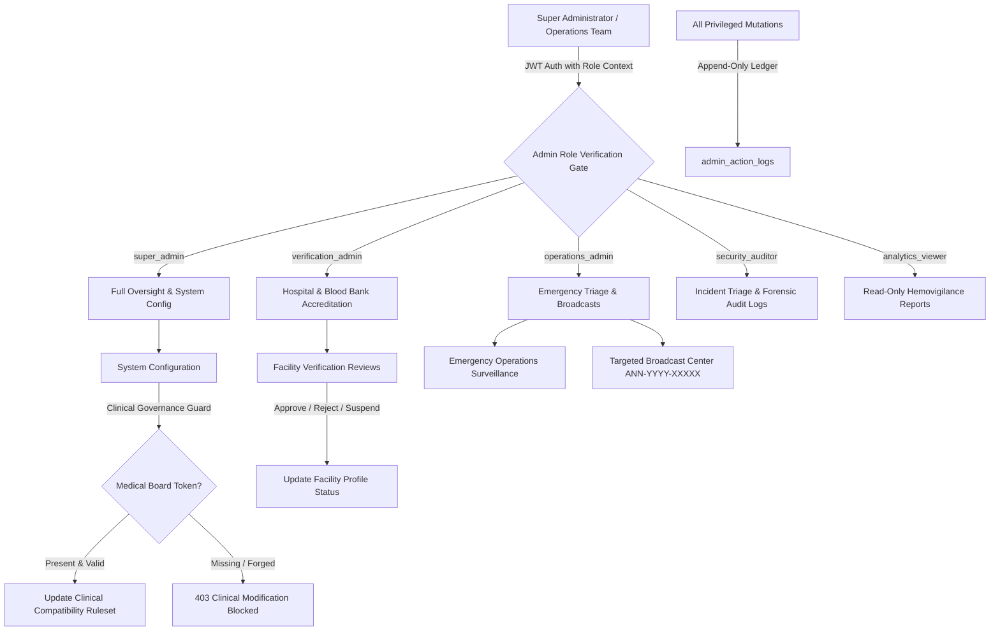

# BloodLink – Super Admin Command Center & Global Platform Architecture

## 1. System Overview

The **BloodLink Super Admin Command Center** provides centralized, multi-tenant administrative oversight, emergency operations surveillance, facility accreditation auditing, and platform security operations across the entire BloodLink ecosystem.

---

## 2. Super Admin Command Center Modules (`admin-dashboard.html`)

The Super Admin Command Center is organized into **10 specialized operational modules**:

| # | Module | DOM Identifier | Primary Clinical / Administrative Function |
|---|--------|----------------|-------------------------------------------|
| 1 | **Global Overview** | `#tab-overview` | Real-time platform aggregates, active donors, verified facilities, code-red queues, system health indicators, and 3D network telemetry. |
| 2 | **User Administration** | `#tab-users` | Global search & filter by role and status, profile inspection, account suspension with mandatory audit reason. |
| 3 | **Facility Accreditation** | `#tab-facilities` | Hospital and blood bank verification queue, license checks, physical cold-chain audit validation, approval/rejection workflows. |
| 4 | **Global Emergency Operations** | `#tab-emergency` | Platform-wide triage surveillance, code-red SLA monitoring, stalled request detection, matching progress. |
| 5 | **Inventory Intelligence** | `#tab-inventory` | $8 \times 5$ regional component matrix (8 ABO/RhD groups $\times$ 5 components), stock levels, critical shortage alerts, cold-chain compliance. |
| 6 | **Analytics & Reports** | `#tab-analytics` | Platform metrics: fulfillment rate, crossmatch-to-transfusion ratio (C:T), verification velocity, regional demand distributions. |
| 7 | **Broadcast & Alerts** | `#tab-broadcast` | Targeted platform broadcast center (`ANN-YYYY-XXXXX`) filtered by audience (all, donors, patients, hospitals, blood_banks). |
| 8 | **Security & Incidents** | `#tab-security` | Forensic audit log stream, incident triage (`INC-YYYY-XXXXX`), brute-force anomaly investigation notes, resolution tracking. |
| 9 | **System Configuration** | `#tab-configuration` | Emergency escalation limits, matching radii, registration switches, and protected clinical compatibility rules. |
| 10 | **Admin Access Control** | `#tab-roles` | Granular administrative role assignments (`operations_admin`, `verification_admin`, `security_auditor`, `analytics_viewer`). |

### Statutory Administrative Governance Notice
All administrative interfaces prominently display the mandatory statutory notice:
> **ADMINISTRATIVE & CLINICAL GOVERNANCE NOTICE**  
> The BloodLink Super Admin Command Center provides centralized operational oversight, infrastructure management, and institutional accreditation auditing. All clinical decisions, blood crossmatching, biological screening, and transfusion authorizations remain under the strict authority of qualified medical practitioners and certified blood establishments.

---

## 3. Provisioning & Privilege Escalation Protection

1. **Non-Selectable Public Role**:
   `super_admin` is omitted from the public signup options in `auth.html`. Any registration payload attempting to inject `account_type = "super_admin"` is constrained by database RLS and triggers.
2. **Secure CLI Setup Utility (`scripts/provision_super_admin.py`)**:
   Initial Super Admin accounts must be bootstrapped via secure CLI requiring server-side service-role access or environment execution.
3. **Privilege Self-Escalation Barrier**:
   Ordinary administrators (e.g. `operations_admin`, `verification_admin`) cannot assign or promote another account to `super_admin`. Only an authenticated `super_admin` can manage administrative role bindings in `public.admin_roles`.
4. **Self-Suspension Guard**:
   Super Admins are blocked from suspending their own accounts, preventing accidental administrative lockouts.
5. **No Client-Side Credential Exposure**:
   All administrative actions execute through the authenticated Python Flask REST API (`/api/v1/admin/*`) or Supabase client using session JWT Bearer tokens with strict Row Level Security.
